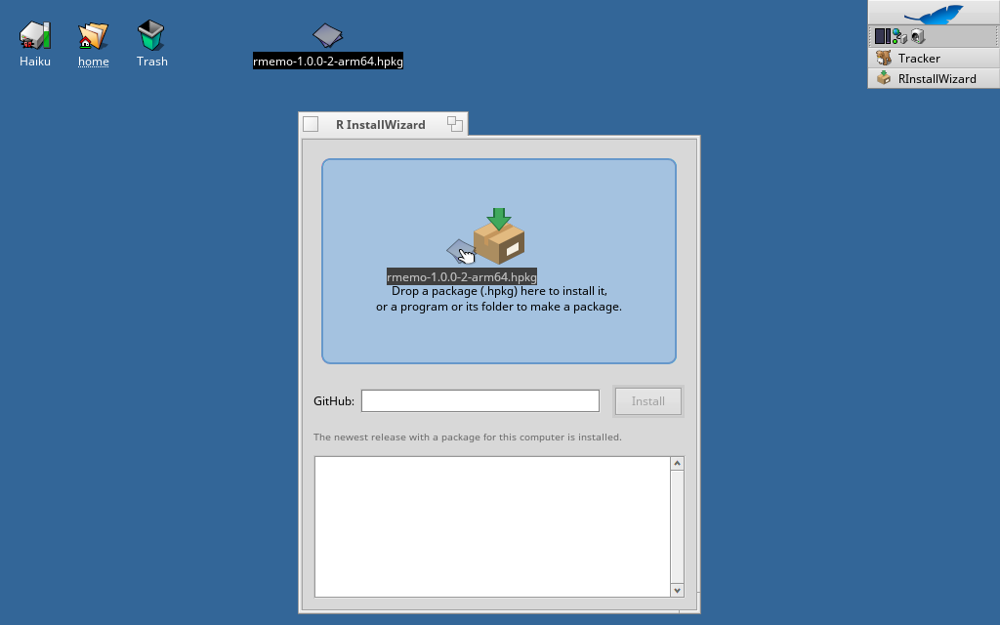
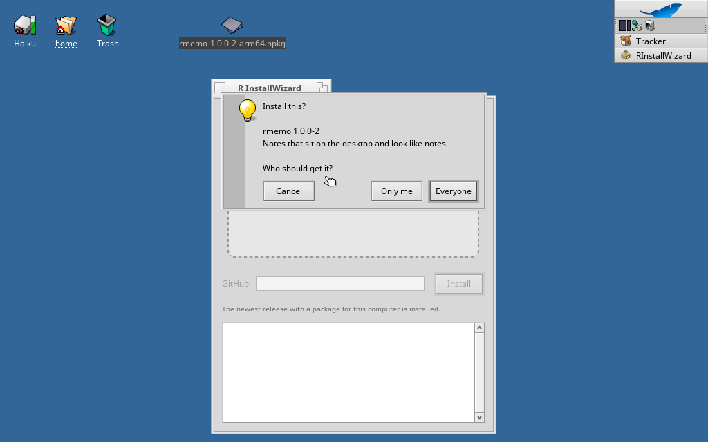
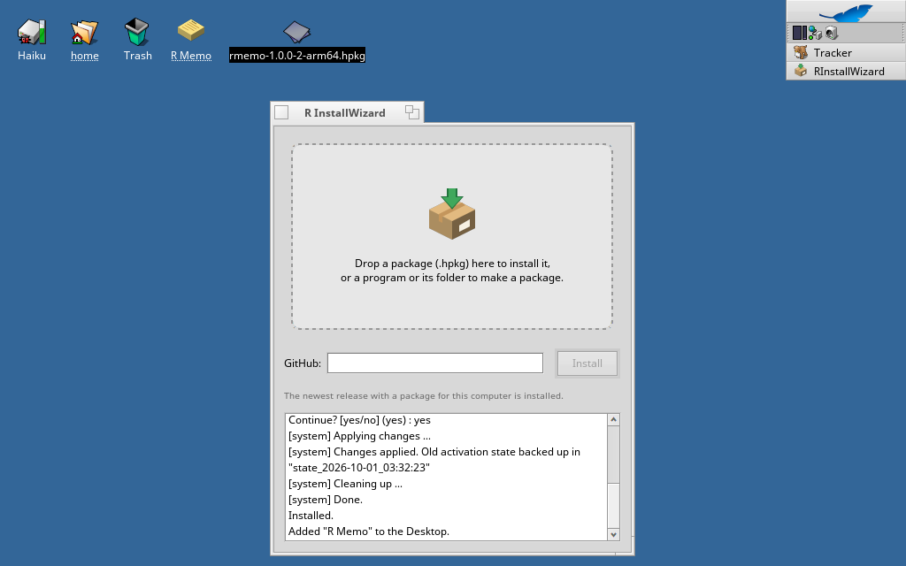

# Haiku 用 R InstallWizard

[English](README.md) · [한국어](README.ko.md)

ターミナルを使わずに Haiku のパッケージをインストールします。`.hpkg` をウィンドウにドロップするか GitHub のアドレスを入力し、誰にインストールするかと、デスクトップにもアイコンを作るかを選ぶだけです。







- **`.hpkg` をドロップすると**インストールします。すべてのユーザー (システム) か自分だけ (ホーム) かを選べます。
- **GitHub のアドレスを入力すると** (`https://github.com/所有者/リポジトリ`、リリースのページ、または `.hpkg` への直接リンク)、このコンピューターのアーキテクチャ用のパッケージがある最新のリリースをダウンロードしてインストールします。
- **プログラムやそのフォルダーをドロップすると**パッケージを作ります。名前、バージョン、作成者、ソースのリンク、インストール先 (アプリケーション、設定、コマンドライン) を尋ねます。ソースフォルダーも一緒にドロップすると `_source` パッケージも作ります。

画面は英語、イタリア語、韓国語、日本語に対応し、Locale 設定の言語リストのうち最初に現れるものを使います。

## pkgman でインストール

| Haiku | コマンド |
| --- | --- |
| 32 ビット x86 (x86_gcc2) | `pkgman add-repo https://pkgman.rainygirl.com/x86_gcc2`<br>`pkgman install rinstallwizard_x86` |
| x86_64 | `pkgman add-repo https://pkgman.rainygirl.com/x86_64`<br>`pkgman install rinstallwizard` |
| arm64 | `pkgman install rinstallwizard` (RENKU イメージにはリポジトリが登録済みです) |

GitHub の各リリースには 3 つのアーキテクチャの `.hpkg` も添付されているので、R InstallWizard に `rainygirl/renkuos-rinstallwizard` と入力して自分自身をインストールすることもできます。

インストール後、Deskbar → Applications から **R InstallWizard** を起動してください。Tracker で `.hpkg` ファイルの **Open with** からも開けます。

## ソースからビルド

Haiku 上で `openssl3_devel` (32 ビットのシステムでは `openssl3_x86_devel`) をインストールしてからビルドします。

```sh
make                # x86_64、arm64
setarch x86 make    # 32 ビットの x86_gcc2 システム
```

ほかのシステムからのクロスビルドは `tools/cross-build.sh` を参照してください。

## ライセンス

MIT

## AI の利用について

R InstallWizard の一部は AI コーディングツール (Anthropic の Claude) の支援を受けて開発されました。すべてのコードは作者がレビューし、テストしています。
