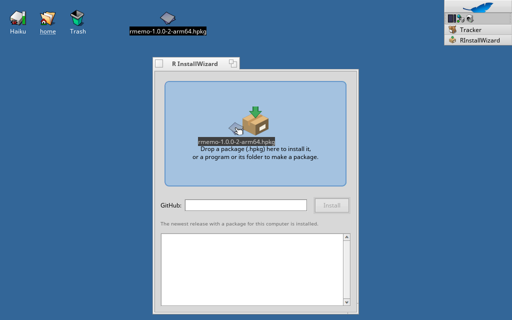
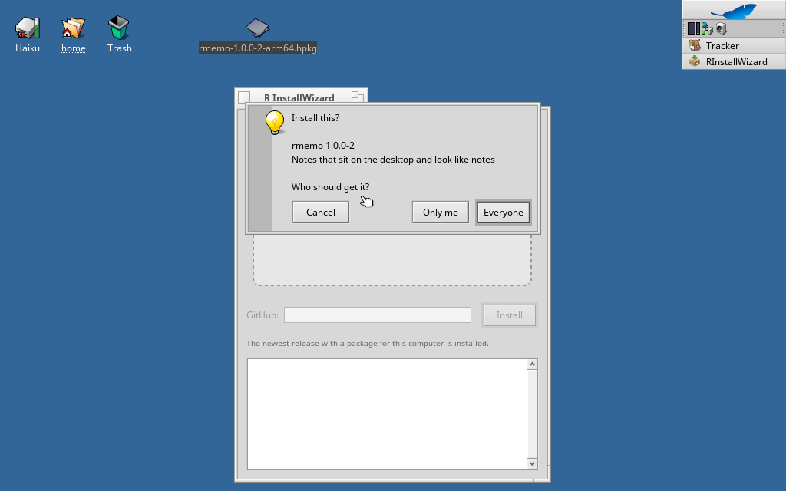
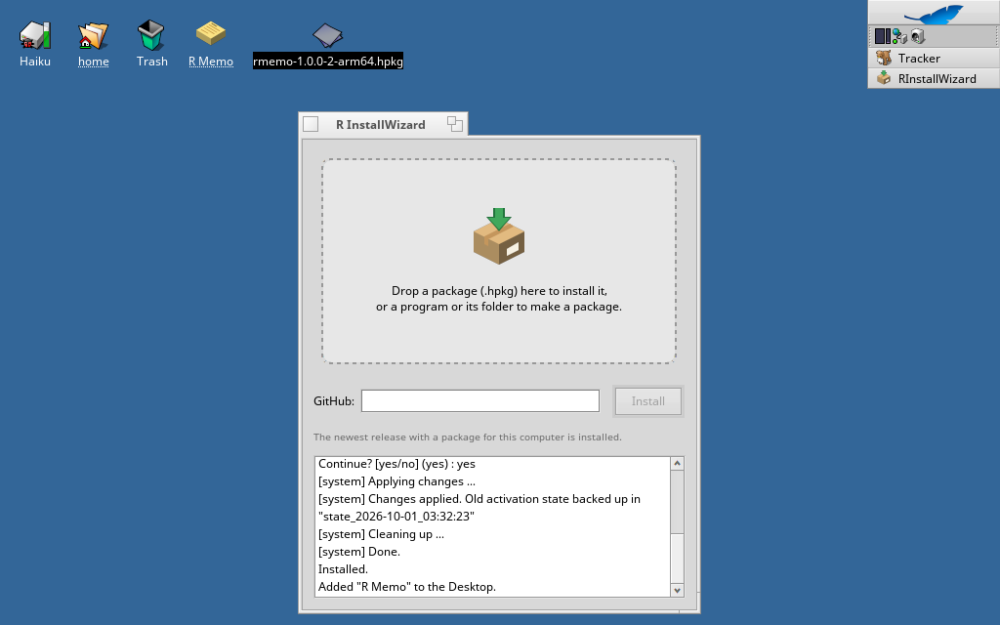

# Haiku용 R InstallWizard

[English](README.md) · [日本語](README.ja.md)

터미널 없이 Haiku 패키지를 설치합니다. `.hpkg`를 창에 끌어다 놓거나 GitHub 주소를 입력한 뒤, 누구에게 설치할지 고르고 바탕화면에도 아이콘을 만들지 정하면 됩니다.







- **`.hpkg`를 끌어다 놓으면** 설치합니다. 모든 사용자(시스템)나 현재 사용자(홈) 중에서 고를 수 있습니다.
- **GitHub 주소를 입력하면**(`https://github.com/소유자/저장소`, 릴리스 페이지, 또는 `.hpkg` 직접 링크) 이 컴퓨터의 아키텍처에 맞는 패키지가 있는 가장 최근 릴리스를 내려받아 설치합니다.
- **프로그램이나 그 폴더를 끌어다 놓으면** 패키지를 만듭니다. 이름, 버전, 만든 사람, 소스 링크, 설치 위치(응용 프로그램, 환경설정, 명령줄)를 묻습니다. 소스 폴더도 함께 놓으면 `_source` 패키지도 만듭니다.

화면은 영어, 이탈리아어, 한국어, 일본어를 지원하며, Locale 환경설정의 언어 목록에서 이 중 가장 앞에 있는 언어를 씁니다.

## pkgman으로 설치

| Haiku | 명령 |
| --- | --- |
| 32비트 x86 (x86_gcc2) | `pkgman add-repo https://pkgman.rainygirl.com/x86_gcc2`<br>`pkgman install rinstallwizard_x86` |
| x86_64 | `pkgman add-repo https://pkgman.rainygirl.com/x86_64`<br>`pkgman install rinstallwizard` |
| arm64 | `pkgman install rinstallwizard` (RENKU 이미지에는 저장소가 이미 등록되어 있습니다) |

GitHub 릴리스마다 세 아키텍처의 `.hpkg`도 올라가 있어서, R InstallWizard에 `rainygirl/renkuos-rinstallwizard`를 입력해 자기 자신을 설치할 수도 있습니다.

설치한 뒤 Deskbar → Applications에서 **R InstallWizard**를 실행하십시오. Tracker에서 `.hpkg` 파일의 **Open with** 메뉴로도 열 수 있습니다.

## 소스에서 빌드

Haiku에서 `openssl3_devel`(32비트 시스템은 `openssl3_x86_devel`)을 설치한 뒤 빌드합니다.

```sh
make                # x86_64, arm64
setarch x86 make    # 32비트 x86_gcc2 시스템
```

다른 시스템에서 크로스 빌드하는 방법은 `tools/cross-build.sh`에 있습니다.

## 라이선스

MIT

## AI 사용 고지

R InstallWizard의 일부는 AI 코딩 도구(Anthropic Claude)의 도움을 받아 개발했습니다. 모든 코드는 작성자가 검토하고 테스트했습니다.
