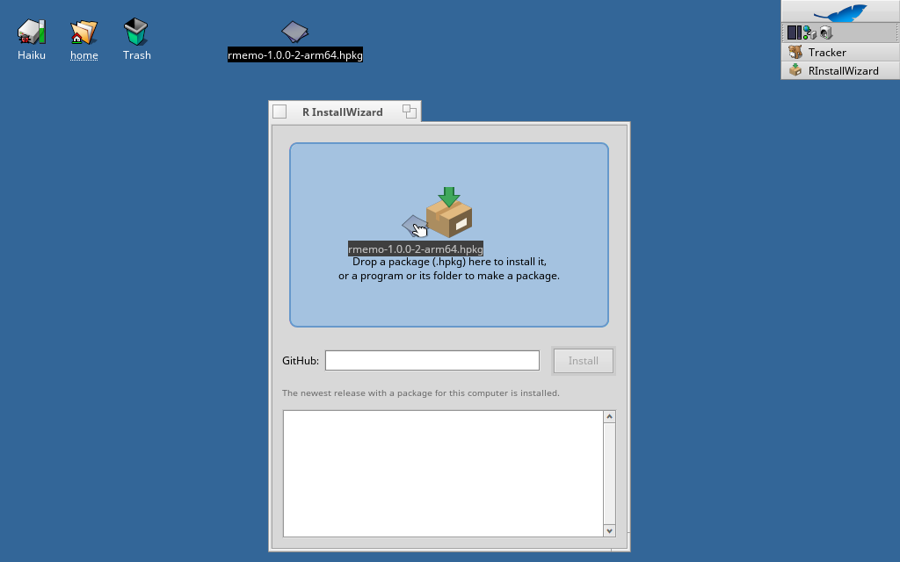
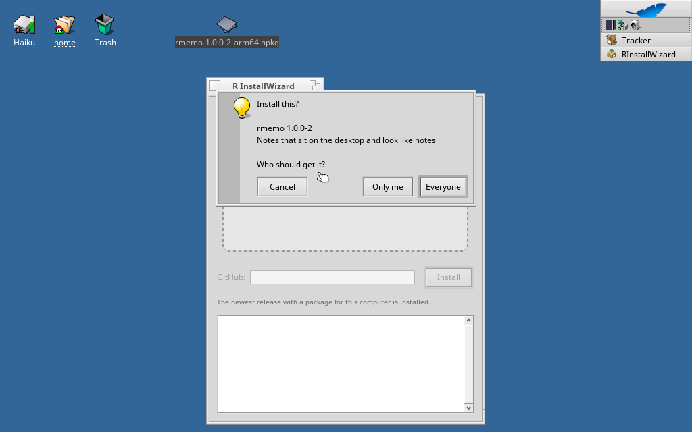
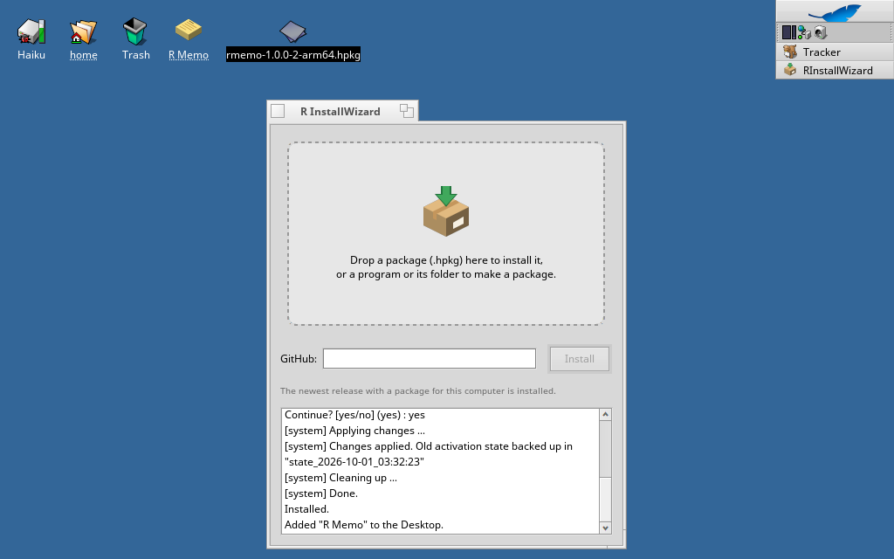

# R InstallWizard for Haiku

[한국어](README.ko.md) · [日本語](README.ja.md)

Installs Haiku packages without a terminal. Drop an `.hpkg` on the window, or type a GitHub address, choose who gets it, and say whether the app should also get an icon on the Desktop.







- **Drop an `.hpkg`** to install it, for everyone (system) or only for you (home).
- **Type a GitHub address** (`https://github.com/owner/repo`, a release page, or a direct link to an `.hpkg`): the newest release with a package for this computer's architecture is downloaded and installed.
- **Drop a program or its folder** to make a package of it: it asks for the name, the version, your name, the source link and where it should be installed (Applications, Preferences or the command line). Drop the source folder too and a matching `_source` package is made as well.

The window speaks English, Italian, Korean and Japanese, following the first of those in the Locale preferences.

## Install with pkgman

| Haiku | Commands |
| --- | --- |
| 32-bit x86 (x86_gcc2) | `pkgman add-repo https://pkgman.rainygirl.com/x86_gcc2`<br>`pkgman install rinstallwizard_x86` |
| x86_64 | `pkgman add-repo https://pkgman.rainygirl.com/x86_64`<br>`pkgman install rinstallwizard` |
| arm64 | `pkgman install rinstallwizard` (RENKU images have the repository already) |

Every release on GitHub also carries the three `.hpkg` files, so R InstallWizard can install itself from `rainygirl/haiku-rinstallwizard`.

Then start **R InstallWizard** from Deskbar → Applications. Tracker also offers it in **Open with** for `.hpkg` files.

## Build from source

On Haiku, with `openssl3_devel` installed (`openssl3_x86_devel` on a 32-bit system):

```sh
make                # x86_64, arm64
setarch x86 make    # 32-bit x86_gcc2 systems
```

Cross-building from another system is described in `tools/cross-build.sh`.

## License

MIT

## AI disclosure

Parts of R InstallWizard were developed with the assistance of AI coding tools (Anthropic's Claude). All code has been reviewed and tested by the author.
